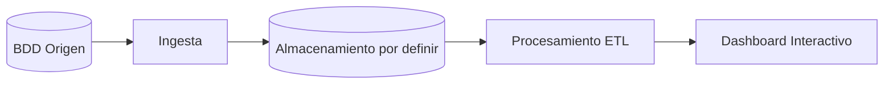

# Proyecto 2 · Datos

## Descripción y objetivo
Implementación de un flujo de datos estructurado. La extracción inicial se realiza desde una Base de Datos (BDD) de origen para su posterior transformación y visualización.

## Arquitectura



## Fuentes de datos
| Fuente | URL / origen | Formato | Frecuencia de actualización | Licencia | Última ingesta |
|---|---|---|---|---|---|
| [Nombre BBDD Origen] | [URL/Host] | BDD / SQL | [Frecuencia] | [Licencia] | [Fecha] |

## Estructura del repositorio
| Carpeta | Contenido |
|---|---|
| `ingesta/` | Scripts de extracción desde la base de datos origen |
| `etl/` | Transformaciones y limpieza |
| `dashboard/` | Aplicación de visualización de datos |

## Cómo desplegar el entorno
```bash
# Entorno base preparado. 
# Las instrucciones de despliegue con Docker se añadirán en bloques posteriores.
cp .env.example .env
```

## Bitácora de prácticas

### Bloque 0 · Entorno
- **Objetivo:** Preparar la estructura base de repositorios.
- **Pasos realizados:** 
  1. Inicialización de Git y estructura de carpetas.
  2. Creación de `.gitignore` para omitir archivos sensibles.
  3. Redacción de la documentación base.
  *(Nota: Despliegue de contenedores pospuesto a futuros bloques)*.
- **Problemas encontrados y solución:** Ninguno.
- **Resultado:** Repositorio estructurado y listo para el desarrollo.

### Bloque 1 · Ingesta batch
- **Objetivo:** [Pendiente]
- **Pasos realizados:** [Pendiente]
- **Problemas encontrados y solución:** [Pendiente]
- **Resultado:** [Pendiente]

## Decisiones técnicas
| Decisión | Alternativa descartada | Motivo |
|---|---|---|
| [ ] | [ ] | [ ] |

## Incidencias resueltas
- **Problema:** [ ]
- **Causa:** [ ] 
- **Solución:** [ ]